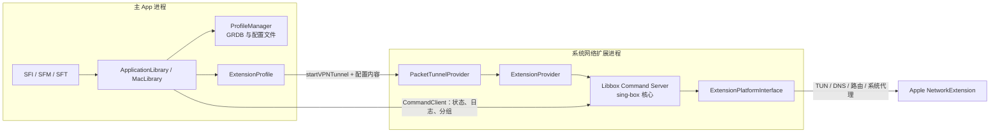
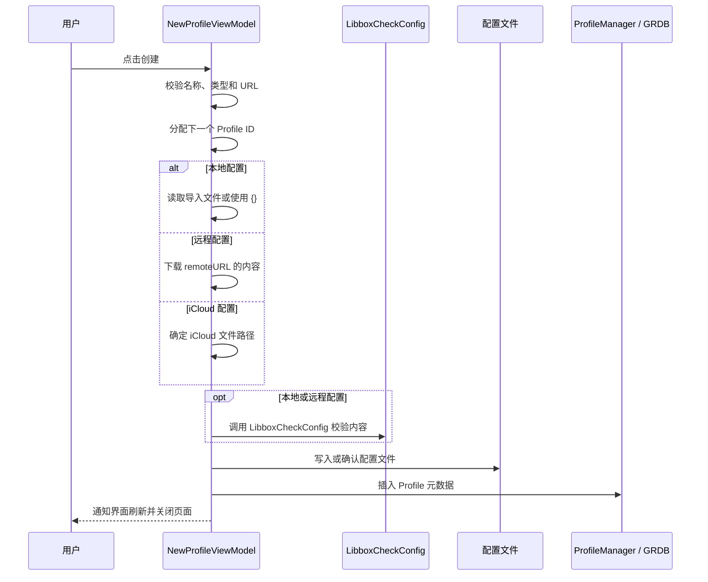

# sing-box-for-apple 小白源码入门指南

> 本文基于当前工作区源码整理，面向“会一点编程，但没做过 Apple 平台开发”的读者。
>
> 读完本文，你不需要立刻掌握所有 Swift 语法，但应该能回答三个问题：
>
> 1. 每个主要目录负责什么？
> 2. 一份配置是如何保存并被选中的？
> 3. 点击“启动”后，界面、系统扩展和 sing-box 核心如何协作？

本文是**源码阅读指南**，不是 sing-box 配置文件的编写教程。

---

## 目录

- [1. 先建立整体认识](#1-先建立整体认识)
- [2. 阅读前需要知道的概念](#2-阅读前需要知道的概念)
- [3. 项目目录地图](#3-项目目录地图)
- [4. 技术栈与第三方依赖](#4-技术栈与第三方依赖)
- [5. 应用如何启动](#5-应用如何启动)
- [6. 配置 Profile 如何保存](#6-配置-profile-如何保存)
- [7. 点击“启动”后发生了什么](#7-点击启动后发生了什么)
- [8. 界面如何获得状态、日志和连接信息](#8-界面如何获得状态日志和连接信息)
- [9. 停止与重新加载](#9-停止与重新加载)
- [10. 数据到底存在哪里](#10-数据到底存在哪里)
- [11. 如何构建项目](#11-如何构建项目)
- [12. 推荐的源码阅读路线](#12-推荐的源码阅读路线)
- [13. 新手最容易混淆的地方](#13-新手最容易混淆的地方)
- [14. 测试与练习建议](#14-测试与练习建议)
- [15. 术语速查](#15-术语速查)

---

## 1. 先建立整体认识

项目根目录的 [README.md](README.md) 将它定义为 sing-box 的 iOS、macOS、tvOS 客户端。

可以先把整个应用理解成两个部分：

1. **主 App：遥控器**
   - 展示配置、状态、日志和连接信息。
   - 创建或导入配置。
   - 告诉系统“启动”或“停止”服务。
2. **网络扩展：真正运行核心的地方**
   - 由 Apple 系统在独立进程中启动。
   - 初始化 Libbox 和 sing-box 核心。
   - 把核心要求的 TUN、DNS、路由和代理设置翻译成 Apple 的系统 API 调用。

因此，**主 App 本身并不直接转发网络数据包**。核心网络逻辑位于 Libbox/sing-box 一侧，Swift 代码负责界面、持久化以及 Apple 平台适配。



记住这句话，后面的源码就容易理解了：

> **主 App 管配置和控制，系统扩展运行核心，Libbox 连接 Swift 与 sing-box。**

---

## 2. 阅读前需要知道的概念

### 2.1 Swift 与 SwiftUI

- **Swift**：Apple 平台的主要编程语言。
- **SwiftUI**：声明式 UI 框架。界面会根据状态自动刷新，而不是手动逐个点亮或修改控件。

项目中常见的几个属性包装器：

| 写法 | 小白理解 | 项目中的例子 |
| --- | --- | --- |
| `@State` | 当前 View 自己维护的小状态 | 当前选中的页面、弹窗是否显示 |
| `@StateObject` | 当前 View 创建并持有一个可观察对象 | `DashboardView` 创建 `DashboardViewModel` |
| `@ObservedObject` | 观察外部传入的对象 | `ActiveDashboardView` 观察 Dashboard 的 ViewModel |
| `@EnvironmentObject` | 从上层视图注入的共享对象 | 多页面共享 `ExtensionEnvironments` |
| `@Published` | 值变化时通知 SwiftUI 刷新 | 配置列表、VPN 状态、日志缓冲区 |

例如，[DashboardViewModel.swift](ApplicationLibrary/Views/Dashboard/DashboardViewModel.swift) 中的 `profileList` 使用了 `@Published`。`reload()` 更新配置列表后，界面就能收到变化。

### 2.2 App Extension

App Extension 是由系统管理、在独立进程中运行的功能模块。这个项目包含多种扩展：

- Packet Tunnel 网络扩展：运行代理核心。
- Intents 扩展：支持快捷指令。
- Widget/Control 扩展：提供系统控制开关。
- File Provider 扩展：向文件应用暴露工作目录。
- Share Extension：处理系统分享进来的内容。

所以项目里的 `Extension` 不是“给主 App 随便加一点代码”，而是一个**有独立生命周期和运行权限的程序组件**。

### 2.3 NetworkExtension

这是 Apple 的网络能力框架。阅读本项目时，先认识三个类型：

| 类型 | 作用 |
| --- | --- |
| `NETunnelProviderManager` | 主 App 用来安装、保存和加载 VPN 配置 |
| `NEPacketTunnelProvider` | 网络扩展的基类，系统通过它启动和停止隧道 |
| `NEPacketTunnelNetworkSettings` | 描述 TUN 地址、DNS、路由和代理等网络设置 |

### 2.4 Libbox

`Libbox` 是 Swift 与 sing-box 核心之间的绑定层。项目中可以看到：

- `LibboxCheckConfig`：检查配置内容。
- `LibboxSetup`：初始化核心运行环境。
- `LibboxNewCommandServer`：创建核心命令服务。
- `LibboxNewCommandClient`：让界面订阅状态、日志和分组。
- `LibboxTunOptionsProtocol`：把核心需要的 TUN 参数传给 Apple 平台层。

Xcode 工程以 `Libbox.xcframework` 的形式引用它。**核心实现不在本仓库这些 Swift 文件里**，不要试图在 `Library/` 中寻找 sing-box 的完整代理协议实现。

### 2.5 GRDB 与 App Group

- **GRDB**：Swift 的 SQLite 数据库库。本项目用它保存 Profile 元数据和应用偏好。
- **App Group**：让主 App 与扩展访问同一个共享容器的机制。配置、数据库和核心工作文件需要跨进程访问，因此不能只放在主 App 的私有目录中。

---

## 3. 项目目录地图

第一次打开项目时，不建议从所有文件逐个阅读。先记住下面这张地图。

| 目录 | 主要职责 | 新手优先级 |
| --- | --- | --- |
| [SFI](SFI) | iOS 主 App 入口、iOS 主界面与编辑器适配 | 高 |
| [SFM](SFM) | macOS 标准主 App 的轻量入口 | 高 |
| [SFM.System](SFM.System) | macOS System Extension 版本的启动与打包资源 | 低 |
| [SFT](SFT) | tvOS 主 App 入口与界面 | 低 |
| [ApplicationLibrary](ApplicationLibrary) | 跨平台共享界面、ViewModel、页面组件和部分服务 | 高 |
| [MacLibrary](MacLibrary) | macOS 专属窗口、菜单栏、生命周期和主界面 | 中 |
| [Library](Library) | 跨平台非 UI 核心：数据库、网络扩展控制、Libbox 平台适配、偏好设置 | 最高 |
| [Extension](Extension) | iOS Packet Tunnel 扩展入口 | 高 |
| [TVExtension](TVExtension) | tvOS Packet Tunnel 扩展入口 | 低 |
| [SystemExtension](SystemExtension) | macOS System Extension 入口 | 中 |
| [IntentsExtension](IntentsExtension) | 启动、停止、重启、更新配置等快捷指令 | 中 |
| [WidgetExtension](WidgetExtension) | 系统控制开关，读取和切换隧道状态 | 中 |
| [FileProviderExtension](FileProviderExtension) | 将核心工作目录提供给系统文件应用 | 低 |
| [ShareExtension](ShareExtension) | 系统分享流程；当前实现包含 Taildrop 文件发送 | 低 |
| [Frameworks](Frameworks) | 本地编辑器相关包，如 Runestone 与 TreeSitterJSON5 | 低 |
| [SFIUITests](SFIUITests)、[SFMUITests](SFMUITests)、[SFTUITests](SFTUITests) | 各平台 UI 截图测试 | 低 |
| [Makefile](Makefile) | 构建、归档、发布、格式化和 lint 命令入口 | 中 |

`Jailbreak/`、`JailbreakDaemon/`、`HelperService/` 等目录涉及越狱环境、特权助手和进程归属查询。它们属于进阶平台适配，第一次阅读可以跳过。

### 三个最容易混淆的 Library

- `ApplicationLibrary`：主要放**共享 UI 和 UI 状态**。
- `MacLibrary`：放 **macOS 专属 UI 和应用行为**。
- `Library`：放**共享业务逻辑与系统能力**，不是传统意义上的“工具函数合集”。

---

## 4. 技术栈与第三方依赖

| 技术或依赖 | 在项目中的用途 |
| --- | --- |
| Swift / SwiftUI | 应用与界面主体 |
| Combine | 将数据库、命令客户端和 ViewModel 的变化传递给界面 |
| Swift Concurrency | 使用 `async/await`、`Task` 处理异步配置读写和生命周期 |
| NetworkExtension | 安装、控制和实现 Packet Tunnel |
| Libbox | 调用 sing-box 核心及其命令服务 |
| GRDB | SQLite 数据库读写与迁移 |
| BinaryCodable | 编解码部分偏好值和扩展消息 |
| Runestone / CodeEditSourceEditor / Tree-sitter | 配置文本编辑与语法支持 |
| PLCrashReporter | 崩溃报告支持 |
| QRCode | 二维码相关界面能力 |
| fastlane | 多平台截图等自动化任务 |

依赖版本可在 [Package.resolved](sing-box.xcodeproj/project.xcworkspace/xcshareddata/swiftpm/Package.resolved) 中查看。`Frameworks/Runestone` 还通过 Git submodule 管理，定义见 [.gitmodules](.gitmodules)。

---

## 5. 应用如何启动

### 5.1 iOS：从 `@main` 开始

第一入口是 [SFI/Application.swift](SFI/Application.swift)：

```swift
@main
struct Application: App {
    // ...
}
```

`@main` 表示程序入口。它做了几件关键事情：

1. 通过 `@UIApplicationDelegateAdaptor` 接入 `ApplicationDelegate`。
2. 创建共享的 `ExtensionEnvironments`。
3. 创建 `WindowGroup`，展示 `MainView`。
4. 用 `.environmentObject(...)` 把共享对象注入视图树。

随后有两条路线：

- **生命周期路线**：[SFI/ApplicationDelegate.swift](SFI/ApplicationDelegate.swift) 初始化崩溃处理、语言、后台任务、Profile Server、报告传输服务和 File Provider Domain。
- **界面路线**：[SFI/MainView.swift](SFI/MainView.swift) 根据设备和系统版本选择 TabView 或分栏布局。

页面不是散落在主 App 中各自注册，而是集中在 [NavigationPage.swift](ApplicationLibrary/Views/NavigationPage.swift)：

- Dashboard：配置与总览。
- Groups：代理分组。
- Connections：活动连接。
- Logs：日志。
- Tools：工具。
- Settings：设置。

`NavigationPage.contentView` 将页面枚举映射到具体 SwiftUI View，是理解导航结构的好入口。

### 5.2 macOS：入口很薄，逻辑在 MacLibrary

[SFM/Application.swift](SFM/Application.swift) 只负责入口和组装 `MacApplication`。主要逻辑位于：

- [MacLibrary/ApplicationDelegate.swift](MacLibrary/ApplicationDelegate.swift)：初始化服务、菜单栏行为、后台更新任务，以及登录启动后的服务恢复。
- [MacLibrary/MainView.swift](MacLibrary/MainView.swift)：使用 `NavigationSplitView` 组织侧栏和详情页面。

macOS 还有 `SFM.System` 形态。其启动代码会把 `Variant.useSystemExtension` 设为 `true`，后续共享代码据此选择 System Extension 的 Bundle ID、目录、XPC 和权限逻辑。

### 5.3 tvOS：复用同一套共享逻辑

[SFT/Application.swift](SFT/Application.swift) 同样创建 `ExtensionEnvironments` 并展示主界面。大量业务代码通过条件编译和共享模块复用，因此不建议初学者分别把三个平台完整读一遍。

---

## 6. 配置 Profile 如何保存

### 6.1 Profile 不是单纯的一段 JSON

[Profile.swift](Library/Database/Profile.swift) 中的 `Profile` 是一条数据库记录，主要字段包括：

| 字段 | 含义 |
| --- | --- |
| `id` | 数据库中的唯一编号 |
| `name` | 用户看到的名称 |
| `type` | `.local`、`.icloud` 或 `.remote` |
| `path` | 实际配置文件的位置 |
| `remoteURL` | 远程配置的下载地址 |
| `autoUpdate` / `autoUpdateInterval` | 自动更新开关和间隔 |
| `lastUpdated` | 上次更新时间 |

**Profile 记录和配置正文是分开的**：

- 数据库保存“这份配置叫什么、在哪里、如何更新”。
- 文件保存“核心真正读取的 JSON 内容”。

### 6.2 新建配置的完整链路

核心代码在 [NewProfileViewModel.swift](ApplicationLibrary/Views/Profile/NewProfileViewModel.swift)。



对应源码步骤：

1. `createProfile(...)` 检查必填字段。
2. `createProfileBackground()` 获取下一个 ID。
3. 根据 Profile 类型准备内容：
   - 本地：读取用户选择的文件；没有导入文件时使用 `{}`。
   - 远程：通过 `HTTPClient.getStringAsync` 下载内容。
   - iCloud：准备 iCloud 文档路径，文件不存在时写入 `{}`。
4. 本地和远程配置使用 `LibboxCheckConfig` 校验；iCloud 分支在这里只负责准备路径和文件。
5. 本地和远程配置通常写到 `configs/config_<id>.json`。
6. 创建 `Profile` 对象，通过 `ProfileManager.create` 写入数据库。
7. 远程配置还会配置后台更新任务。

### 6.3 数据库层怎么读

建议按以下顺序看：

1. [ProfileManager.swift](Library/Database/ProfileManager.swift)：`create/get/list/update/delete`，是最直观的数据访问 API。
2. [Database.swift](Library/Database/Database.swift)：创建 `settings.db`，定义 `profiles`、`preferences` 等表及迁移。
3. [Profile+RW.swift](Library/Database/Profile+RW.swift)：根据 Profile 类型读取或写入实际配置文件。
4. [SharedPreferences+Database.swift](Library/Database/SharedPreferences+Database.swift)：将偏好设置编码后保存到 `preferences` 表。

一个容易忽略的细节：`SharedPreferences` 虽然名字里有 Preferences，但当前实现主要使用共享数据库，而不是简单的 `UserDefaults`。

### 6.4 远程配置不等于“任意订阅格式自动转换”

当前新建远程 Profile 的主流程是：下载文本，然后直接调用 `LibboxCheckConfig` 校验。阅读或修改这里时，不要默认它会自动把任意 Base64 订阅、节点分享链接都转换成 sing-box 配置。

---

## 7. 点击“启动”后发生了什么

这是整个项目最值得先吃透的一条链路。

### 7.1 主 App：准备参数并请求系统启动

入口在 [StartStopButton.swift](ApplicationLibrary/Views/Dashboard/Components/StartStopButton.swift)：

1. 用户点击按钮。
2. `switchProfile(true)` 调用 `profile.start()`。
3. 这里的 `profile` 是 `ExtensionProfile`，不是数据库里的 `Profile`。

接着进入 [ExtensionProfile.swift](Library/Network/ExtensionProfile.swift) 的 `start()`：

1. 必要时读取 iCloud Profile。
2. 启用 `NETunnelProviderManager`。
3. 应用 Always On、On Demand 和其他协议设置。
4. 保存 VPN 配置到系统偏好。
5. `prepareStartOptions()` 找到当前选中的数据库 Profile。
6. 通过 `profile.readAsync()` 读出完整配置正文，放入 `options["configContent"]`。
7. 将其他设置一起放进 options。
8. 调用 `manager.connection.startVPNTunnel(options: options)`。

可以将 start options 理解成主 App 交给网络扩展的“启动包裹”，其中最重要的物品就是 `configContent`。

### 7.2 系统扩展：初始化 Libbox 并启动核心

iOS 的 [Extension/PacketTunnelProvider.swift](Extension/PacketTunnelProvider.swift) 很简短：

```swift
class PacketTunnelProvider: ExtensionProvider {}
```

真正的共享逻辑在 [ExtensionProvider.swift](Library/Network/ExtensionProvider.swift)。系统启动扩展后调用 `startTunnel(options:)`，主要步骤如下：

1. 确定 base、working、temp 目录。
2. 解析启动参数；如果系统之后无参数唤醒扩展，还可以读取之前持久化的启动参数。
3. 检查 `configContent` 是否存在。
4. 创建并填充 `LibboxSetupOptions`。
5. 调用 `LibboxSetup` 初始化核心环境。
6. 通过 `LibboxNewCommandServer` 创建命令服务。
7. 启动 Command Server。
8. 在 `startService()` 中调用 `commandServer.startOrReloadService(configContent, options: ...)`。
9. 核心开始按照配置运行。

到这里，主 App 的任务基本完成，核心已经运行在网络扩展进程中。

### 7.3 核心如何创建 Apple 的 TUN 网络

核心需要平台能力时，会回调 [ExtensionPlatformInterface.swift](Library/Network/ExtensionPlatformInterface.swift)。

最重要的方法是 `openTun(...)`：

1. 从 `LibboxTunOptionsProtocol` 读取 MTU、DNS、IPv4/IPv6 地址和路由。
2. 创建 `NEPacketTunnelNetworkSettings`。
3. 填充 `NEDNSSettings`、`NEIPv4Settings`、`NEIPv6Settings`。
4. 如果配置启用 HTTP 代理，还会填充 `NEProxySettings`。
5. 调用 `setTunnelNetworkSettings`，把设置交给 Apple 系统。
6. 获取隧道文件描述符并返回给 Libbox。

这段代码体现了一个重要分工：

> sing-box 核心决定“需要什么样的虚拟网络”，Swift 平台层负责“怎样让 iOS/macOS/tvOS 创建它”。

### 7.4 一张图记住完整启动链路

```text
StartStopButton
    ↓
ExtensionProfile.start()
    ↓ 读取选中 Profile + 配置正文 + 偏好设置
NEVPNConnection.startVPNTunnel(options)
    ↓ Apple 系统启动扩展进程
PacketTunnelProvider / ExtensionProvider.startTunnel()
    ↓
LibboxSetup → LibboxNewCommandServer → startOrReloadService(configContent)
    ↓
sing-box 核心请求平台能力
    ↓
ExtensionPlatformInterface.openTun()
    ↓
NEPacketTunnelNetworkSettings → 系统 TUN / DNS / 路由 / 代理
```

---

## 8. 界面如何获得状态、日志和连接信息

这里有两套互补机制。

### 8.1 系统 VPN 状态

[ExtensionProfile.swift](Library/Network/ExtensionProfile.swift) 的 `register()` 监听 `NEVPNStatusDidChange` 通知，然后更新：

- `status`
- `connectedDate`

它们都是 `@Published` 属性，因此按钮、连接时长和 Dashboard 能随状态刷新。

这套机制回答的是：**系统认为隧道现在处于什么状态？**

### 8.2 核心运行数据

[CommandClient.swift](Library/Network/CommandClient.swift) 包装 Libbox Command Client：

- `status`：流量和运行状态。
- `groups` / `outbounds`：代理分组和出站信息。
- `logBuffer`：核心日志。
- `connections`：活动连接。
- `clashMode`：Clash 模式。

本地模式使用 `LibboxNewCommandClient`；远程控制模式使用 `LibboxNewRemoteCommandClient`。连接目标由 [CommandTarget.swift](Library/Network/CommandTarget.swift) 统一管理。

这套机制回答的是：**核心内部正在发生什么？**

例如，日志页不是直接读取一个本地日志文件，而是通过 Command Client 接收日志，再在 [LogViewModel.swift](ApplicationLibrary/Views/Log/LogViewModel.swift) 中按级别和搜索词过滤、批量刷新并限制可见数量。

---

## 9. 停止与重新加载

### 9.1 停止服务

主链路如下：

1. `StartStopButton` 调用 `ExtensionProfile.stop()`。
2. 主 App 请求 Libbox `serviceClose()`。
3. 调用 `stopVPNTunnel()`。
4. 系统进入 `ExtensionProvider.stopTunnel(with:)`。
5. 扩展关闭核心服务、重置平台接口并关闭 Command Server。

因此，停止并不只是把按钮文字改成“Start”，而是要同时结束核心服务和系统隧道。

### 9.2 不停止隧道，重新加载配置

[ExtensionProfile.swift](Library/Network/ExtensionProfile.swift) 的 `reloadService()` 会：

1. 重新准备配置和启动参数。
2. 使用 `ExtensionStartOptions.encode` 编码消息。
3. 通过 `NETunnelProviderSession.sendProviderMessage` 发给正在运行的扩展。

扩展侧的 `handleAppMessage` 再解码参数、保存快照，并调用 `startOrReloadService` 重新加载核心配置。

[Profile+Update.swift](Library/Database/Profile+Update.swift) 也复用了这条路径：远程 Profile 更新后，如果它是当前选中的 Profile 且服务已连接，就触发重新加载。

---

## 10. 数据到底存在哪里

[FilePath.swift](Library/Shared/FilePath.swift) 统一定义共享目录、缓存目录、工作目录和 iCloud 目录。

| 数据 | 位置或机制 | 相关源码 |
| --- | --- | --- |
| Profile 元数据 | App Group 共享目录中的 `settings.db`，表 `profiles` | `Database.swift` |
| 应用偏好 | 同一个数据库的 `preferences` 表 | `SharedPreferences+Database.swift` |
| 本地/远程 Profile 正文 | 共享目录下的 `configs/config_<id>.json` | `NewProfileViewModel.swift` |
| iCloud Profile 正文 | iCloud Documents 下对应路径 | `Profile+RW.swift` |
| 核心工作文件 | `workingDirectory` | `FilePath.swift` |
| 缓存与临时文件 | `cacheDirectory` 或启动时计算的 temp 路径 | `ExtensionProvider.swift` |
| 扩展启动参数快照 | base 目录下的启动参数快照文件 | `ExtensionStartOptions.swift`、`ExtensionProvider.swift` |

不要把这些路径写死成某台机器上的绝对路径。App Group、平台、System Extension 形态都会影响实际位置。

---

## 11. 如何构建项目

### 11.1 环境准备

你需要：

1. macOS。
2. 与当前工程部署目标和 SDK 用法兼容的 Xcode。
3. Git submodule 和 Swift Package 依赖。
4. 真机调试时可用的签名团队，以及与 Bundle ID、App Group、Network Extension 等能力匹配的签名配置。
5. 完整的 `Libbox.xcframework`。

先拉取子模块：

```bash
git submodule update --init --recursive
```

然后用 Xcode 打开：

```text
sing-box.xcodeproj
```

可按学习目标选择 scheme：

- `SFI`：iOS。
- `SFM`：macOS 标准形态。
- `SFM.System`：macOS System Extension 形态。
- `SFT`：tvOS。

### 11.2 使用 Makefile

[Makefile](Makefile) 已提供构建入口：

```bash
make build_ios
make build_macos
make build_macos_standalone
make build_tvos
```

这些命令内部调用 `xcodebuild`，并通过 `xcbeautify` 整理输出。使用命令行前需要确认相关工具已安装。

格式化与 lint 入口：

```bash
make fmt
make lint
```

首次阅读源码时不需要执行归档、上传、公证和 DMG/PKG 打包命令，它们属于发布流程。

### 11.3 当前工作区的一个构建注意事项

Xcode 工程引用了 `Libbox.xcframework`，但当前工作区中未找到该 framework，仓库内也没有看到生成它的构建脚本。因此，直接构建前需要先从项目对应的发行或核心构建渠道补齐它，并确认 Xcode 能解析引用。

同样，真机运行 Network Extension 不是普通 SwiftUI Demo：签名、Bundle ID、App Group 和系统权限任一不匹配，都可能导致安装或启动失败。

本文只整理构建入口，未在当前环境执行完整编译。

---

## 12. 推荐的源码阅读路线

不要按字母顺序读文件，按一条用户操作链路读。

### 第 1 站：找到程序入口

阅读：

- [SFI/Application.swift](SFI/Application.swift)
- [SFI/MainView.swift](SFI/MainView.swift)
- [NavigationPage.swift](ApplicationLibrary/Views/NavigationPage.swift)

带着问题读：应用第一个页面从哪里来？共享状态对象是谁创建的？页面枚举如何变成具体 View？

### 第 2 站：理解 Dashboard

阅读：

- [DashboardView.swift](ApplicationLibrary/Views/Dashboard/DashboardView.swift)
- [DashboardViewModel.swift](ApplicationLibrary/Views/Dashboard/DashboardViewModel.swift)
- [ActiveDashboardView.swift](ApplicationLibrary/Views/Dashboard/ActiveDashboardView.swift)

带着问题读：配置列表从哪里来？加载中、未安装 VPN 配置、远程控制和正常 Dashboard 分别显示什么？

### 第 3 站：追踪一次新建配置

阅读：

- [NewProfileViewModel.swift](ApplicationLibrary/Views/Profile/NewProfileViewModel.swift)
- [Profile.swift](Library/Database/Profile.swift)
- [ProfileManager.swift](Library/Database/ProfileManager.swift)
- [Profile+RW.swift](Library/Database/Profile+RW.swift)
- [Database.swift](Library/Database/Database.swift)

带着问题读：配置正文与 Profile 元数据分别保存在哪里？远程下载之后为什么还要校验？为什么文件 IO 要放到后台执行？

### 第 4 站：追踪启动按钮

阅读：

- [StartStopButton.swift](ApplicationLibrary/Views/Dashboard/Components/StartStopButton.swift)
- [ExtensionProfile.swift](Library/Network/ExtensionProfile.swift)

带着问题读：UI 的按钮如何找到当前配置？`configContent` 在哪一步被放进启动参数？

### 第 5 站：进入系统扩展

阅读：

- [Extension/PacketTunnelProvider.swift](Extension/PacketTunnelProvider.swift)
- [ExtensionProvider.swift](Library/Network/ExtensionProvider.swift)
- [ExtensionPlatformInterface.swift](Library/Network/ExtensionPlatformInterface.swift)

带着问题读：扩展入口为什么只有一行继承？Libbox 在哪一步初始化？TUN 参数如何转换成 Apple 网络设置？

### 第 6 站：理解状态回传

阅读：

- [CommandClient.swift](Library/Network/CommandClient.swift)
- [ExtensionEnvironments.swift](Library/Network/ExtensionEnvironments.swift)
- [LogViewModel.swift](ApplicationLibrary/Views/Log/LogViewModel.swift)

带着问题读：系统 VPN 状态与核心状态有什么区别？日志和连接信息如何到达 UI？

### 第 7 站：再看扩展能力

阅读：

- [Intents.swift](IntentsExtension/Intents.swift)：快捷指令如何复用启动、停止和 Profile 更新能力。
- [ServiceToggleControl.swift](WidgetExtension/ServiceToggleControl.swift)：系统控制开关如何切换状态。
- [Profile+Update.swift](Library/Database/Profile+Update.swift)：远程配置更新后如何触发 reload。

完成这七站后，再阅读 macOS System Extension、XPC、Root Helper、崩溃报告、Tailscale/Taildrop 和终端工具等进阶模块，会轻松很多。

---

## 13. 新手最容易混淆的地方

### 13.1 `Profile` 和 `ExtensionProfile` 不是同一个东西

- `Profile`：数据库中的配置记录，知道配置名称、类型和文件路径。
- `ExtensionProfile`：对 `NEVPNManager` 的控制封装，负责安装、启动、停止和监听系统 VPN 状态。

这是阅读启动链路时最重要的命名区分。

### 13.2 `PacketTunnelProvider` 很短，不代表逻辑很少

各平台扩展入口通常只有：

```swift
class PacketTunnelProvider: ExtensionProvider {}
```

真正逻辑在共享的 `ExtensionProvider` 中。这样 iOS、tvOS 和 macOS 不必复制同一套核心启动代码。

### 13.3 主 App 与网络扩展不在同一个进程

不能简单地把主 App 的内存变量当成扩展也能直接访问。跨进程协作主要依赖：

- App Group 共享文件和数据库。
- `startVPNTunnel(options:)` 启动参数。
- `sendProviderMessage` 消息。
- Libbox Command Client/Server。
- macOS System Extension 形态下的 XPC 等机制。

### 13.4 `@MainActor` 与 `nonisolated` 是在处理线程边界

- `@MainActor`：确保 UI 和相关状态主要在主 actor 上操作。
- `nonisolated`：允许方法离开该 actor 执行。
- `BlockingIO.run`：把阻塞文件 IO 移出主线程。

例如 `Profile.read()` 在 Debug 下明确要求不能在主线程调用，而 `readAsync()` 使用 `BlockingIO.run` 包装。这不是多余仪式，而是在避免磁盘操作卡住界面。

### 13.5 不要一开始试图读懂所有 `#if`

`#if os(macOS)`、`#if os(iOS)`、`#if JAILBREAK` 等条件编译用于复用代码。第一次追踪功能时，先选定一个平台，例如 iOS，只读该分支；其他分支暂时当作注释跳过。

### 13.6 `Library` 不是 sing-box 核心源码

`Library/Network` 中大量调用以 `Libbox` 开头，它们是绑定 API。Swift 代码展示的是“如何调用核心”和“如何适配 Apple 系统”，不是代理协议本身的全部实现。

---

## 14. 测试与练习建议

### 14.1 现有测试怎么看

项目包含：

- `UITests/`：共享 UI 测试与启动测试。
- `SFIUITests/`、`SFMUITests/`、`SFTUITests/`：各平台截图测试。
- `fastlane/`：截图自动化配置。

从当前测试源码看，重点偏向 UI 启动和截图，而不是对 sing-box 核心协议做完整单元测试。核心正确性不能仅依赖这些 UI 测试判断。

### 14.2 三个安全的小练习

1. **画配置数据流**
   - 从 `NewProfileViewModel.createProfile()` 开始。
   - 用纸画出“输入 → 校验 → 文件 → 数据库 → UI 刷新”。
2. **给启动链路加断点**
   - `StartStopButton.switchProfile`
   - `ExtensionProfile.start`
   - `ExtensionProvider.startTunnel`
   - `ExtensionPlatformInterface.openTun`
   - 观察配置正文和系统参数分别在哪一步出现。
3. **比较启动与重载**
   - 对比 `startVPNTunnel` 和 `sendProviderMessage`。
   - 说明为什么“更新配置”不一定需要完整停止并重建 VPN。

建议先不要直接修改核心启动参数、路由或权限代码。先能完整解释调用链，再做小改动。

---

## 15. 术语速查

| 术语 | 简明解释 |
| --- | --- |
| sing-box | 底层通用代理核心 |
| SFI | 项目的 iOS 客户端形态 |
| SFM | 项目的 macOS 客户端形态 |
| SFT | 项目的 tvOS 客户端形态 |
| Profile | 一份配置的数据库元数据 |
| `configContent` | 传给核心的完整配置文本 |
| Libbox | Swift 调用 sing-box 核心的绑定层 |
| Command Server | 扩展侧提供状态、日志、控制能力的核心服务 |
| Command Client | 主 App 或远程客户端连接 Command Server 的入口 |
| Packet Tunnel | Apple 提供的包隧道网络扩展形态 |
| TUN | 虚拟网络接口，核心通过它接管和处理流量 |
| App Group | 主 App 与扩展之间的共享容器机制 |
| GRDB | 项目使用的 SQLite 数据库框架 |
| XPC | Apple 的跨进程通信机制，macOS System Extension 相关代码会使用 |
| On Demand | 按系统规则自动连接 VPN 的机制 |
| ViewModel | 保存页面状态与操作逻辑，减少 View 中的业务代码 |

---

## 总结

如果只能记住一条主线，请记住下面这条：

```text
SwiftUI 页面
→ ViewModel / ExtensionEnvironments
→ ExtensionProfile 准备配置并启动系统隧道
→ ExtensionProvider 初始化 Libbox
→ sing-box 核心运行
→ ExtensionPlatformInterface 对接 Apple 网络能力
→ CommandClient 将状态、日志和连接信息带回界面
```

建议先以 iOS 为目标完整走通“新建配置”和“启动服务”两条链路，再看 macOS、tvOS 和各种扩展。这样比从目录顶部逐文件阅读更容易建立正确认识。
